<div align="center">

# Night Glass

**A dark, glassy design system for product showcases — packaged as a Claude Code plugin.**
Near-black canvas, one accent, liquid-glass controls, a live 3D object in the hero and spring motion everywhere.

[](https://lbrdev.github.io/night-glass/)
[](#install-in-claude-code)
[](CHANGELOG.md)
[](LICENSE)

[**Live demo**](https://lbrdev.github.io/night-glass/demo/index.html) ·
[Kit 01–10](https://lbrdev.github.io/night-glass/demo/kit.html) ·
[Kit 11–21](https://lbrdev.github.io/night-glass/demo/kit-2.html) ·
[Kit 22–45](https://lbrdev.github.io/night-glass/demo/kit-3.html)

<br>

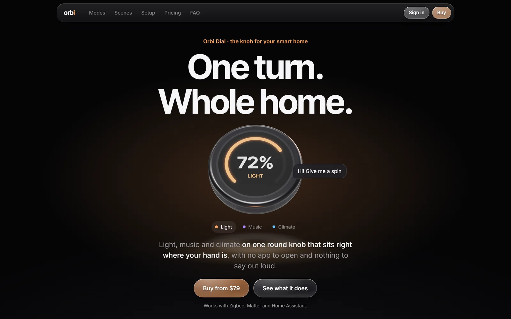

</div>

<br>

## The product is the character

The hero holds a real three.js object, not a picture. It rises in, looks at the cursor, breathes, and lights the page with its own screen. Turn it with a circular gesture and the value follows your finger 1:1.

<div align="center">
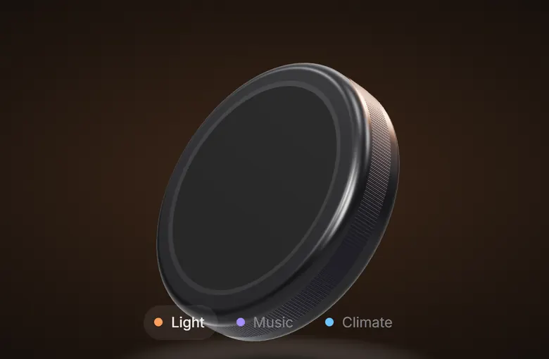
</div>

```js
import { mountHero } from './night-glass-3d.js';
// built-in models: 'puck' or 'slab'
const hero = await mountHero(canvas, { model: 'puck' });

// or your own .glb, with a live picture on its screen mesh
await mountHero(canvas, { model: { url: 'product.glb', screen: 'Screen' } });
```

<br>

## What you get

<table>
<tr>
<td width="50%" valign="top">
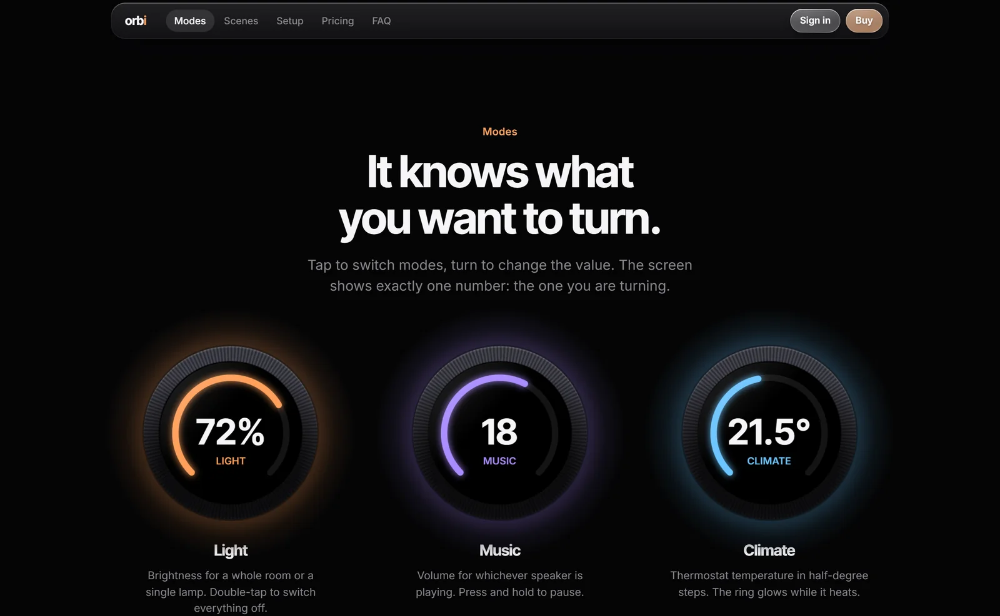
<p><b>Showcase sections</b><br>Feature tiles, side-by-side views, comparisons, pricing, FAQ, CTA strips — each block glows in its own content color.</p>
</td>
<td width="50%" valign="top">
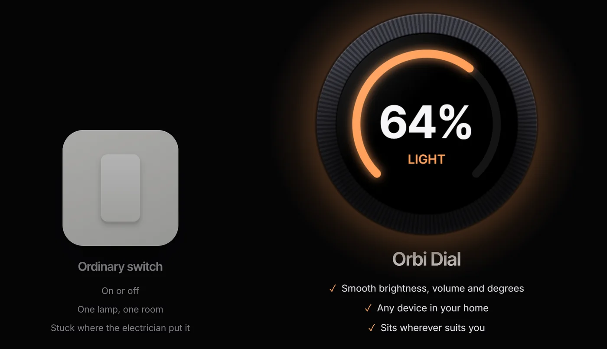
<p><b>Comparison that lands</b><br>The loser is muted and desaturated, the winner gets the light. One rule, no extra decoration.</p>
</td>
</tr>
<tr>
<td valign="top">
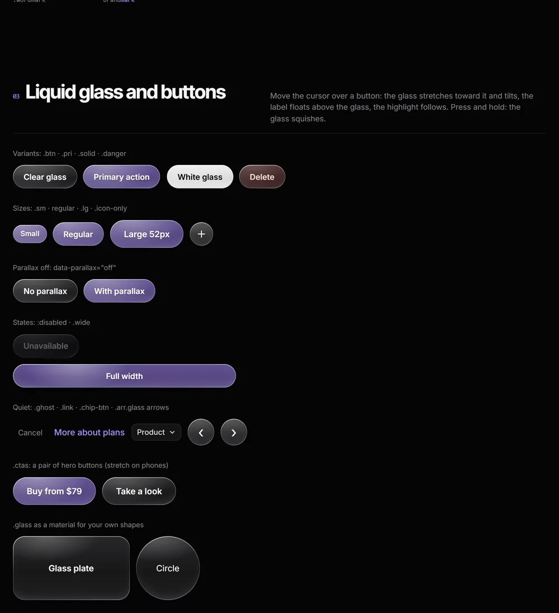
<p><b>Liquid-glass buttons</b><br>A highlight that follows the cursor, a body that leans toward it, a label that floats above the glass, a springy press.</p>
</td>
<td valign="top">
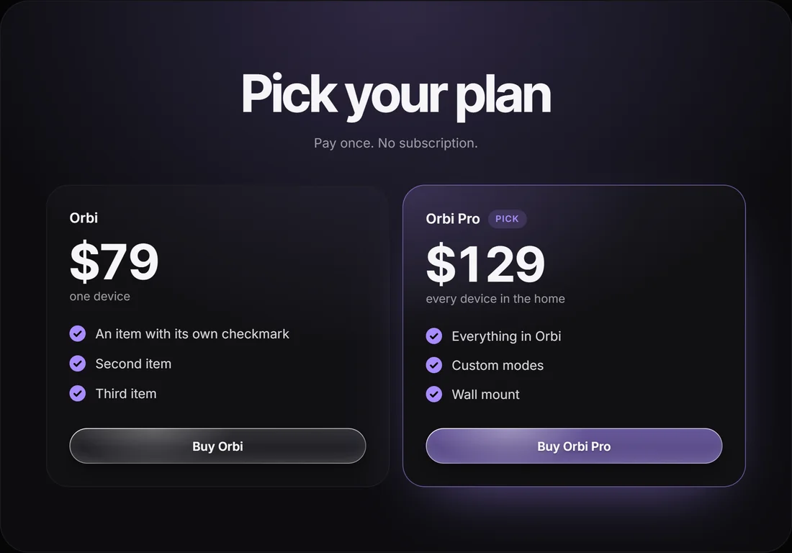
<p><b>Pricing and offers</b><br>Plans with checklists, a glowing pick, a pay-once line. Ready for a real checkout button.</p>
</td>
</tr>
<tr>
<td valign="top">
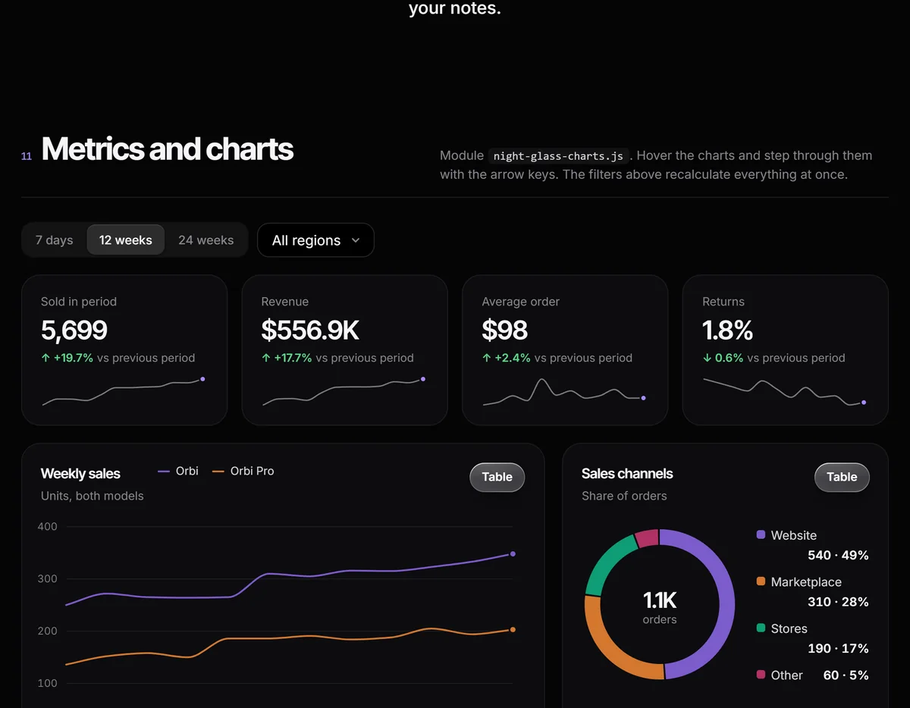
<p><b>Charts and metrics</b><br><code>night-glass-charts.js</code>: lines, bars, donut, sparkline and a table view. The palette is validated for contrast on a dark background.</p>
</td>
<td valign="top">
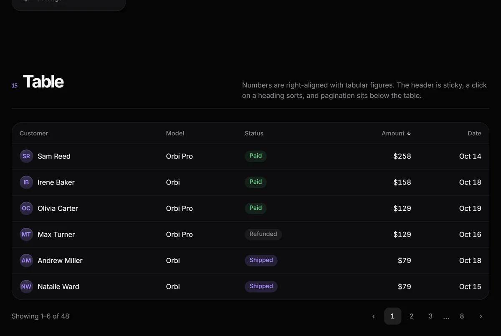
<p><b>App screens</b><br>Sortable tables, row selection, tabs, a tab bar, menus, a custom dropdown, date ranges, toasts, dialogs and a ⌘K palette.</p>
</td>
</tr>
</table>

<table>
<tr>
<td width="33%" align="center">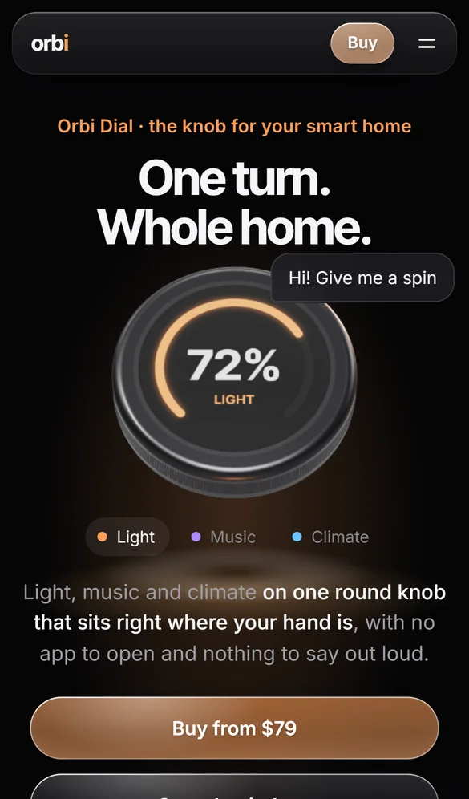</td>
<td width="33%" align="center">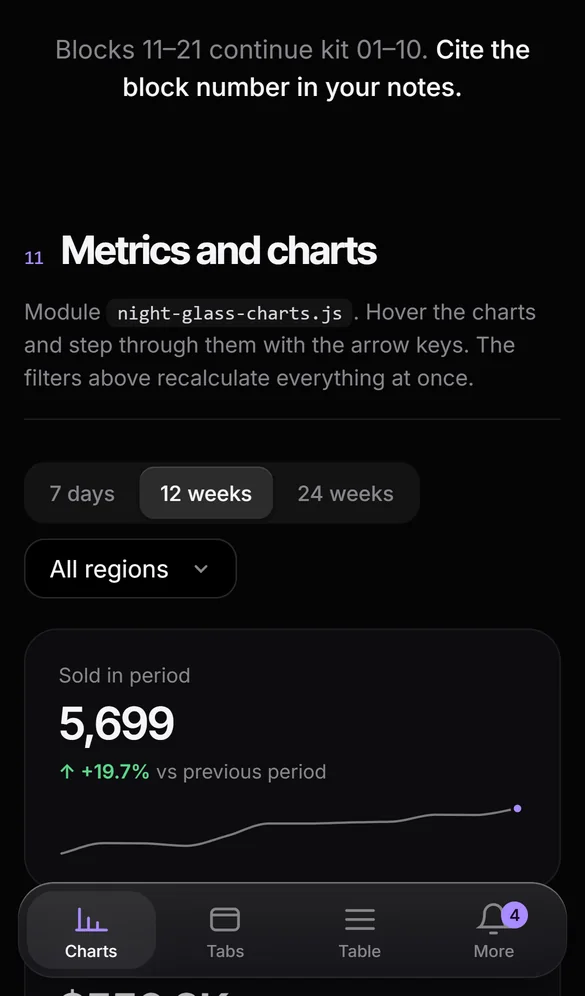</td>
<td width="33%" align="center">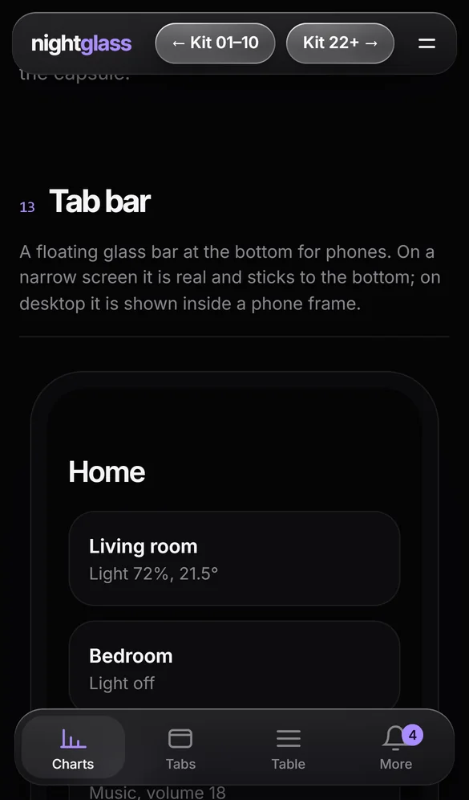</td>
</tr>
<tr><td colspan="3" align="center"><b>Built for phones too</b> — a floating glass tab bar, touch-friendly sizes, steady scrolling in in-app browsers like Telegram.</td></tr>
</table>

<br>

## Install in Claude Code

Inside Claude Code (terminal or app):

```
/plugin marketplace add lbrdev/night-glass
/plugin install night-glass@night-glass
```

Or from a regular shell:

```bash
claude plugin marketplace add lbrdev/night-glass
```

```bash
claude plugin install night-glass@night-glass
```

Restart Claude Code and just ask: *"make a landing page in the Night Glass style"* or *"restyle this page in Night Glass"*. The skill loads on its own.

Update to a new version:

```bash
claude plugin update night-glass@night-glass
```

<details>
<summary><b>Other agents, or without the plugin</b></summary>

Install the skill into Claude Code, Cursor, Codex and other agents that read skills:

```bash
npx skills add lbrdev/night-glass
```

Or copy the skill folder:

```bash
git clone https://github.com/lbrdev/night-glass && cp -r night-glass/skills/night-glass ~/.claude/skills/
```

Or use the CSS and JS directly in any project: they have no dependencies apart from three.js for the 3D hero.

</details>

<br>

## Use it without Claude

```html
<link rel="stylesheet" href="night-glass.css">
<script type="module" src="night-glass.js"></script>

<button class="btn pri">Buy from $79</button>
<button class="btn">See what it does</button>
```

| You want | Take |
| --- | --- |
| Plain CSS | `assets/night-glass.css` — tokens as CSS variables plus every component |
| Tailwind v4 | `assets/tailwind.css` (`@theme`) |
| Tailwind v3 | `assets/tailwind.preset.js` |
| shadcn/ui | `assets/shadcn-theme.css` — drop-in variables |
| A starting page | `templates/landing.html` — a showcase skeleton with placeholders |

<br>

## What's inside

```
skills/night-glass/
  SKILL.md                     how Claude works with the system
  reference/DESIGN.md          principles, tokens, components, do's and don'ts
  assets/night-glass.css       tokens + all components
  assets/night-glass.js        glass highlight, button parallax, reveal, header, setGlow, toast, dialogs, menus
  assets/night-glass-3d.js     3D hero: mountHero(canvas, { model: 'puck' | 'slab' | your .glb })
  assets/night-glass-charts.js lines, bars, donut, sparkline, table view
  assets/tailwind.css          Tailwind v4 (@theme)
  assets/tailwind.preset.js    Tailwind v3
  assets/shadcn-theme.css      shadcn/ui variables
  templates/landing.html       showcase skeleton
  demo/index.html              the Orbi showcase (a fictional product)
  demo/kit*.html               every component, blocks 01–45
```

<br>

## Run the demos locally

Modules and the import map need a server, not `file://`:

```bash
cd skills/night-glass && python -m http.server 8000
```

Then open `http://localhost:8000/demo/index.html`.

<details>
<summary><b>Tests</b></summary>

Playwright Test covers the demo pages: smoke tests (no console errors, no horizontal scroll, dialogs, date menus, dropdown, code sign-in) and visual comparisons against a reference you create on your own machine.

```bash
npm i
```

```bash
npx playwright install chromium
```

```bash
npm run test:smoke
```

```bash
npm run test:update
```

After that, `npm test` shows what changed. Live parts (3D, animated bars, time) are masked.

</details>

<br>

## Credits

Fonts are Inter and Inter Tight (SIL Open Font License). 3D rendering by [three.js](https://threejs.org).

## License

[MIT](LICENSE)
